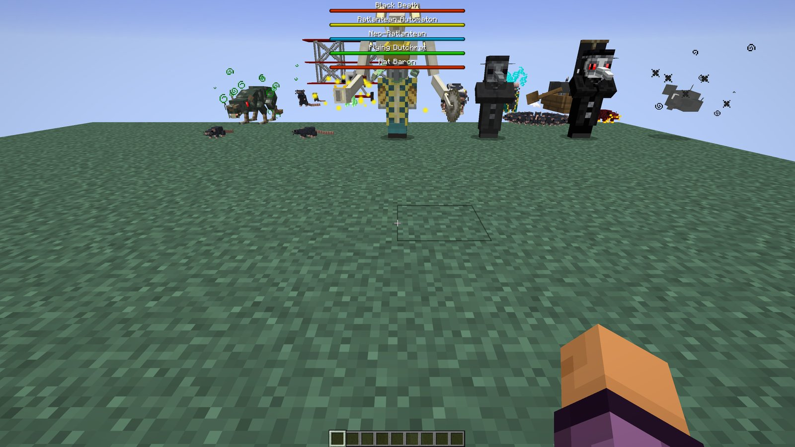
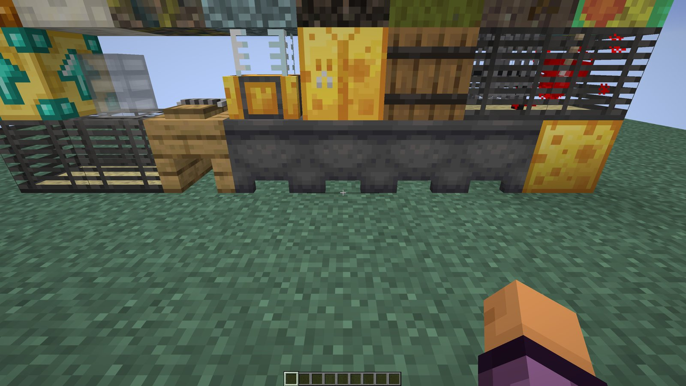

# Rats for Minecraft 1.21.1 and 26.x (unofficial port)

An unofficial port of [Rats](https://www.curseforge.com/minecraft/mc-mods/rats) 8.1.3 (Forge 1.20.1) by Alexthe666 and
GizmoTheMoonPig to Minecraft **1.21.1, 26.1.2, 26.2 and 26.3** for **NeoForge** and **Fabric**.

<b>🇬🇧 English — click to open</b>

## Download

Get the jar for your Minecraft version and loader from the [releases](https://github.com/Vladeezyy/rats-1.21/releases).
Every version needs **[Rampart](https://github.com/Vladeezyy/rampart)** (our library with the model and animation code
the original took from Citadel); Fabric also needs [Fabric API](https://modrinth.com/mod/fabric-api).

- **26.3**: NeoForge 26.3.0.94+, Fabric Loader 0.19.5+ (Fabric API 0.164.0+26.3), Java 25
- **26.2**: NeoForge 26.2.0.93+, Fabric Loader 0.19.5+ (Fabric API 0.161.0+26.2), Java 25
- **26.1.2**: NeoForge 26.1.2+, Fabric Loader 0.19.5+ (Fabric API 0.155.3+26.1.2), Java 25
- **1.21.1**: NeoForge 21.1.197+, Fabric Loader 0.16.14+ (Fabric API 0.116.17+1.21.1), Java 21

The source of each version is on its branch: `main` (1.21.1), `mc/26.1.2`, `mc/26.2`, `mc/26.3`.

## Requirements

- **Rampart** for the same Minecraft version and loader; on Fabric also Fabric API.
- Needed on the server and on every client.
- Ratlantis is a built-in datapack and is on by default; a new world lists it under *More → Data Packs*.

## Features

Everything of Rats 8.1.3:
- **Rats**: wild rats and garbage piles, taming with cheese, commands (wander, follow, stay, harvest, gather,
  hunt, transport, patrol), 235 upgrades (lumberjack, miner, farmer, fisherman, crafting, flight, ethereal, mounts and
  many more), the rat crafting table, rat tubes, cages, holes and traps.
- **Cheese**: milk cauldrons, cheese, blue and nether cheese, the curdling station, cheese ore, chunky cheese tokens.
- **Plague**: plagued rats, plague doctors and their trades, the Black Death, plague beasts and clouds, the Pied Piper
  in raids.
- **Ratlantis**: the dimension of marbled cheese with its bosses (the Ratlantean Automaton, the Neo-Ratlantean, the
  Flying Dutchrat, the Rat Baron), pirats, oratchalcum and Ratlantean gear; the Rat King.

## What this port fixes

16 open issues of the original, each with an automatic test, plus bugs found while porting. In short:
- tamed rats no longer get stuck holding cheese or stop working after a while (lumberjacks, farmers, carriers);
- rats keep working when their owner is offline or the world is open to LAN;
- **rat tubes work again** (broken since 1.14): rats path through tube networks and climb shafts;
- the ethereal rat phases through blocks again, bee rats fight on *Follow Me*, the Flying Dutchrat melees;
- patrol paths survive a restart; the "disable plastic" option is back;
- the original's own mixins (idol upgrade with piglins, sculked upgrade with wardens) are registered, so these
  upgrades work;
- the global loot modifiers (cat gifts, charged creeper chunks, tiny coins) run again.

The full list with causes: [PORTLOG.md](PORTLOG.md).

## Problems and fixes in detail

<b>Tamed rat stuck holding cheese (<a href="https://github.com/AlexModGuy/Rats/issues/838">#838</a>)</b>

**Problem:** a freshly tamed rat holds the cheese forever and does no work.
**Cause:** taming copied the cheese into the rat's hand, and a working rat only puts down items it is allowed to eat.
**Fix:** taming no longer puts the cheese in the hand; a working rat drops food it may not eat.

<b>Rats stop working after a while (<a href="https://github.com/AlexModGuy/Rats/issues/818">#818</a>, <a href="https://github.com/AlexModGuy/Rats/issues/844">#844</a>, <a href="https://github.com/AlexModGuy/Rats/issues/887">#887</a>, <a href="https://github.com/AlexModGuy/Rats/issues/920">#920</a>, <a href="https://github.com/AlexModGuy/Rats/issues/902">#902</a>)</b>

**Problem:** lumberjacks, farmers and carriers work for a while, then stand still.
**Cause:** a rat that could not reach a tree or chest retried it forever; paths ended at the follow range (12 blocks),
not at the radius set with the staff; the planter only planted some seeds.
**Fix:** unreachable targets are skipped for a minute, paths cover the whole radius, the farmer plants any seed on dry
farmland.

<b>Rats stop when the owner is offline or on LAN (<a href="https://github.com/AlexModGuy/Rats/issues/850">#850</a>, <a href="https://github.com/AlexModGuy/Rats/issues/945">#945</a>)</b>

**Problem:** rats sit down and do nothing while their owner is away.
**Cause:** vanilla's sit goal sits every pet whose owner is offline.
**Fix:** the rats' own sit goal only sits on command.

<b>Rat tubes do nothing (<a href="https://github.com/AlexModGuy/Rats/issues/907">#907</a>)</b>

**Problem:** rats ignore rat tubes.
**Cause:** the tube navigation was lost in 1.14, and the 1.19+ tube was too narrow for a rat.
**Fix:** tamed rats path through tube networks (only through open or joined sides), climb up and down shafts, and the
tube inside is 10 px again as in 1.12.

<b>Ethereal rat does not phase through blocks (<a href="https://github.com/AlexModGuy/Rats/issues/871">#871</a>)</b>

**Problem:** the ethereal upgrade does nothing.
**Cause:** since 1.19 the rat got its physics and gravity back every tick.
**Fix:** no physics and no gravity for ethereal rats, straight paths.

<b>Bee rat and Flying Dutchrat never melee (<a href="https://github.com/AlexModGuy/Rats/issues/822">#822</a>, <a href="https://github.com/AlexModGuy/Rats/issues/848">#848</a>)</b>

**Problem:** a flying rat on *Follow Me* ignores the owner's target; the Flying Dutchrat never hits in melee.
**Cause:** a flying rat in the air had no path, so its attack goal never started; 1.19 made the Dutchrat hover 4
blocks above its target and flee to the north-west after every sword throw.
**Fix:** flying rats attack, the Dutchrat hovers 1 block above as in 1.16 and backs off in a random direction.

<b>Smaller fixes (<a href="https://github.com/AlexModGuy/Rats/issues/787">#787</a>, <a href="https://github.com/AlexModGuy/Rats/issues/827">#827</a>, <a href="https://github.com/AlexModGuy/Rats/issues/847">#847</a>, <a href="https://github.com/AlexModGuy/Rats/issues/870">#870</a>, <a href="https://github.com/AlexModGuy/Rats/issues/864">#864</a>)</b>

- Patrol paths were cleared on restart: the loaded path is now synced.
- Crash `NoSuchElementException` with the Plague Doctor: damage sources without an owner are null-safe.
- "Fell from a great height" after teleporting to the owner: the fall distance is reset.
- The bucket upgrade played its sound every tick: at most once a second.
- The "disable plastic" option is back as "Plastic in Recipes" (glass recipes when off).

## Compatibility

- [JEI](https://modrinth.com/mod/jei) shows the rat crafting, cauldron and upgrade recipes (both loaders).
- Item and fluid storages work with other mods: NeoForge capabilities, Fabric's transfer API. Energy (the Ratlantis
  reactor) is NeoForge only: Fabric has no common energy API.
- 1.20.1 worlds keep their rats and items: item NBT moves to 1.21 data components on load.
- Rampart replaces Citadel and does not conflict with it.

## Testing

On each Minecraft version and both loaders:
- self-test on a dedicated server: 45 checks (44 on 1.21.1), among them a gameplay scenario for every fixed issue;
- client scene: all 28 mobs, the blocks and the inventory without missing textures or translations;
- a check that no server class loads client code.

## Performance

Server load (issue [#867](https://github.com/AlexModGuy/Rats/issues/867)), NeoForge 1.21.1, 300 cells of carriers and farmers working at once: **+2.2 ms per tick,
about 7.5 µs per rat**. The port removed the heaviest parts of the original: area scans now run the cheap block checks
first, empty searches back off, item searches are throttled like vanilla's target goals, static maps no longer grow
and the navigation is no longer re-created every 3 seconds. Path searches went from 31 % to 19 % of the rat phase.
Client: 100 tamed rats in view cost about 5 µs a frame each.

Numbers for every version: [PORTLOG.md](PORTLOG.md).

## Bug reports

Found a bug in this port? Please report it in [our issues](https://github.com/Vladeezyy/rats-1.21/issues), not to the
original authors: their tracker is for Rats 1.20.1 and older. Add the Minecraft version, the loader, the mod list and
`logs/latest.log` (or the crash report).

## Credits and license

- Original mod: **Rats** by Alexthe666 and GizmoTheMoonPig ([source](https://github.com/AlexModGuy/Rats)), LGPL-3.0.
- Port: Vladeezyy. Code and assets: **LGPL-3.0-only** ([LICENSE](LICENSE), GPL-3.0 text in
  [COPYING](licenses/COPYING)), Copyright (c) 2026 Vladeezyy and the original authors.
- Forks and modified versions must stay open under the same license and credit the authors. Please download the mod
  only from the official pages.

<b>🇷🇺 Русский — нажмите, чтобы открыть</b>

## Скачать

Jar для своей версии Minecraft и загрузчика — на странице [релизов](https://github.com/Vladeezyy/rats-1.21/releases).
Для каждой версии нужен **[Rampart](https://github.com/Vladeezyy/rampart)** (наша библиотека с кодом моделей и
анимаций, который оригинал брал из Citadel); на Fabric ещё [Fabric API](https://modrinth.com/mod/fabric-api).

- **26.3**: NeoForge 26.3.0.94+, Fabric Loader 0.19.5+ (Fabric API 0.164.0+26.3), Java 25
- **26.2**: NeoForge 26.2.0.93+, Fabric Loader 0.19.5+ (Fabric API 0.161.0+26.2), Java 25
- **26.1.2**: NeoForge 26.1.2+, Fabric Loader 0.19.5+ (Fabric API 0.155.3+26.1.2), Java 25
- **1.21.1**: NeoForge 21.1.197+, Fabric Loader 0.16.14+ (Fabric API 0.116.17+1.21.1), Java 21

Исходники каждой версии — в своей ветке: `main` (1.21.1), `mc/26.1.2`, `mc/26.2`, `mc/26.3`.

## Требования

- **Rampart** для той же версии Minecraft и загрузчика; на Fabric ещё Fabric API.
- Нужен на сервере и у каждого игрока.
- Ратлантида — встроенный датапак, включён по умолчанию; в новом мире он виден в *Дополнительно → Наборы данных*.

## Что есть в моде

Всё из Rats 8.1.3:
- **Крысы**: дикие крысы и мусорные кучи, приручение сыром, команды (бродить, следовать, сидеть, собирать
  урожай, подбирать предметы, охотиться, перевозить, патрулировать), 235 улучшений (лесоруб, шахтёр, фермер, рыбак,
  крафт, полёт, призрачность, ездовые животные и многое другое), крысиный верстак, крысиные трубы, клетки, норы и
  ловушки.
- **Сыр**: котлы с молоком, сыр, голубой и адский сыр, станция створаживания, сырная руда, жетоны Chunky Cheese.
- **Чума**: чумные крысы, чумные доктора и их торговля, Чёрная Смерть, чумные звери и облака, Крысолов в рейдах.
- **Ратлантида**: измерение из мраморного сыра со своими боссами (Ratlantean Automaton, Neo-Ratlantean, Flying
  Dutchrat, Rat Baron), пиратами-крысами, оратчалкумом и ратлантийским снаряжением; Крысиный король.

## Что исправлено в порте

16 открытых issues оригинала, каждый с автотестом, плюс ошибки, найденные при портировании. Кратко:
- приручённые крысы больше не застревают с сыром в лапах и не перестают работать со временем (лесорубы, фермеры,
  перевозчики);
- крысы работают, когда хозяин не в сети или мир открыт по LAN;
- **крысиные трубы снова работают** (сломаны с 1.14): крысы ходят по сети труб и лазают по шахтам;
- призрачная крыса снова проходит сквозь блоки, пчелиные крысы дерутся в режиме *Следовать*, Летучий Голландкрыс бьёт
  вблизи;
- маршруты патруля не пропадают после перезапуска; вернулась настройка отключения пластика;
- собственные миксины оригинала (улучшение-идол и пиглины, скалк-улучшение и хранители) зарегистрированы, эти
  улучшения работают;
- глобальные модификаторы лута (подарки кошек, куски заряженного крипера, крошечные монеты) снова срабатывают.

Полный список с причинами: [PORTLOG.md](PORTLOG.md).

## Проблемы и исправления подробно

<b>Приручённая крыса застревает с сыром (<a href="https://github.com/AlexModGuy/Rats/issues/838">#838</a>)</b>

**Проблема:** только что приручённая крыса навсегда держит сыр и не работает.
**Причина:** при приручении сыр копировался в лапы, а работающая крыса кладёт только то, что ей можно есть.
**Исправление:** сыр в лапы больше не кладётся; работающая крыса выбрасывает еду, которую ей есть нельзя.

<b>Крысы перестают работать со временем (<a href="https://github.com/AlexModGuy/Rats/issues/818">#818</a>, <a href="https://github.com/AlexModGuy/Rats/issues/844">#844</a>, <a href="https://github.com/AlexModGuy/Rats/issues/887">#887</a>, <a href="https://github.com/AlexModGuy/Rats/issues/920">#920</a>, <a href="https://github.com/AlexModGuy/Rats/issues/902">#902</a>)</b>

**Проблема:** лесорубы, фермеры и перевозчики какое-то время работают, потом стоят.
**Причина:** крыса бесконечно пыталась дойти до недоступного дерева или сундука; пути заканчивались на дальности
следования (12 блоков), а не на радиусе, заданном посохом; сажальщик сажал не все семена.
**Исправление:** недоступные цели пропускаются на минуту, пути покрывают весь радиус, фермер сажает любые семена на
сухую грядку.

<b>Крысы встают, когда хозяин не в сети или на LAN (<a href="https://github.com/AlexModGuy/Rats/issues/850">#850</a>, <a href="https://github.com/AlexModGuy/Rats/issues/945">#945</a>)</b>

**Проблема:** пока хозяина нет, крысы сидят и ничего не делают.
**Причина:** ванильная цель «сидеть» сажает любого питомца, чей хозяин не в сети.
**Исправление:** своя цель «сидеть» у крыс срабатывает только по команде.

<b>Крысиные трубы ничего не делают (<a href="https://github.com/AlexModGuy/Rats/issues/907">#907</a>)</b>

**Проблема:** крысы не пользуются трубами.
**Причина:** навигация по трубам потерялась в 1.14, а труба в 1.19+ была слишком узкой для крысы.
**Исправление:** приручённые крысы прокладывают путь по сети труб (только через открытые или соединённые стороны),
лазают по шахтам вверх и вниз, внутренний размер трубы снова 10 px, как в 1.12.

<b>Призрачная крыса не проходит сквозь блоки (<a href="https://github.com/AlexModGuy/Rats/issues/871">#871</a>)</b>

**Проблема:** призрачное улучшение не работает.
**Причина:** с 1.19 крыса каждый тик снова получала физику и гравитацию.
**Исправление:** у призрачной крысы нет физики и гравитации, пути прямые.

<b>Пчелиная крыса и Летучий Голландкрыс не бьют вблизи (<a href="https://github.com/AlexModGuy/Rats/issues/822">#822</a>, <a href="https://github.com/AlexModGuy/Rats/issues/848">#848</a>)</b>

**Проблема:** летающая крыса в режиме *Следовать* не атакует цель хозяина; Летучий Голландкрыс никогда не бьёт вблизи.
**Причина:** у летающей крысы в воздухе не было пути, и цель атаки не запускалась; в 1.19 Голландкрыс завис на 4 блока
над целью и после каждого броска меча улетал на северо-запад.
**Исправление:** летающие крысы атакуют, Голландкрыс висит на 1 блок выше, как в 1.16, и отходит в случайную сторону.

<b>Мелкие исправления (<a href="https://github.com/AlexModGuy/Rats/issues/787">#787</a>, <a href="https://github.com/AlexModGuy/Rats/issues/827">#827</a>, <a href="https://github.com/AlexModGuy/Rats/issues/847">#847</a>, <a href="https://github.com/AlexModGuy/Rats/issues/870">#870</a>, <a href="https://github.com/AlexModGuy/Rats/issues/864">#864</a>)</b>

- Маршруты патруля пропадали после перезапуска: загруженный маршрут теперь синхронизируется.
- Краш `NoSuchElementException` с чумным доктором: источники урона без владельца больше не падают.
- «Разбилась, упав с высоты» после телепорта к хозяину: высота падения сбрасывается.
- Улучшение-ведро играло звук каждый тик: не чаще раза в секунду.
- Вернулась настройка отключения пластика — «Plastic in Recipes» (при выключенной — рецепты со стеклом).

## Совместимость

- [JEI](https://modrinth.com/mod/jei) показывает рецепты крысиного верстака, котлов и улучшений (на обоих загрузчиках).
- Хранилища предметов и жидкостей работают с другими модами: capabilities на NeoForge, transfer API на Fabric.
  Энергия (ратлантийский реактор) — только на NeoForge: у Fabric нет общего API энергии.
- Миры 1.20.1 сохраняют крыс и предметы: NBT предметов при загрузке переносится в компоненты 1.21.
- Rampart заменяет Citadel и не конфликтует с ним.

## Тестирование

На каждой версии Minecraft и обоих загрузчиках:
- самопроверка на выделенном сервере: 45 проверок (44 на 1.21.1), среди них игровой сценарий для каждого исправленного
  issue;
- клиентская сцена: все 28 мобов, блоки и инвентарь без пропавших текстур и переводов;
- проверка, что ни один серверный класс не загружает клиентский код.

## Производительность

Нагрузка на сервер (issue [#867](https://github.com/AlexModGuy/Rats/issues/867)), NeoForge 1.21.1, 300 ячеек перевозчиков и фермеров, работающих одновременно:
**+2.2 мс на тик, около 7.5 мкс на крысу**. Порт убрал самые тяжёлые места оригинала: обход области сначала делает
дешёвые проверки блока, пустые поиски реже повторяются, поиск предметов ограничен, как у ванильных целей, статические
карты больше не растут, навигация не пересоздаётся каждые 3 секунды. Поиск путей — с 31 % до 19 % времени крыс.
Клиент: 100 приручённых крыс в кадре — около 5 мкс на крысу за кадр.

Цифры по всем версиям: [PORTLOG.md](PORTLOG.md).

## Сообщить об ошибке

Нашли ошибку в порте? Пишите в [наши issues](https://github.com/Vladeezyy/rats-1.21/issues), а не авторам оригинала:
их трекер для Rats 1.20.1 и старше. Укажите версию Minecraft, загрузчик, список модов и `logs/latest.log` (или
отчёт о краше).

## Авторы и лицензия

- Оригинальный мод: **Rats**, Alexthe666 и GizmoTheMoonPig ([исходники](https://github.com/AlexModGuy/Rats)), LGPL-3.0.
- Порт: Vladeezyy. Код и ресурсы: **LGPL-3.0-only** ([LICENSE](LICENSE), текст GPL-3.0 в
  [COPYING](licenses/COPYING)), Copyright (c) 2026 Vladeezyy и авторы оригинала.
- Форки и изменённые версии должны оставаться открытыми под той же лицензией и с указанием авторов. Пожалуйста,
  скачивайте мод только с официальных страниц.

